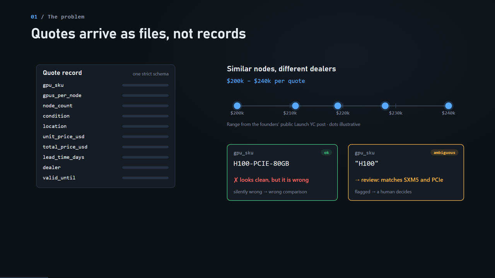

# GPU Quote Intake: messy dealer quotes in, validated records out

<!-- walkthrough-video -->
[](https://medhaja.github.io/gpu-quote-normalizer/)

**[Watch the 3:37 walkthrough](https://medhaja.github.io/gpu-quote-normalizer/)** (plays in your browser)
<!-- /walkthrough-video -->

```bash
pip install -r requirements.txt && python -m intake.demo     # then open http://127.0.0.1:8000
```

(`make demo` does the same. Use `python -m intake.demo --port 8001` if port 8000 is taken. Python 3.11+, no API keys needed.)

> Independent prototype built from public information and synthetic data. Not affiliated with Stoa.

## What it is

A small intake tool for GPU server quotes. It reads dealer spreadsheets (CSV, XLSX) and plain-text quote emails, maps
them onto one strict `Quote` schema (SKU, GPUs per node, node count, condition, location, unit and total price, lead
time, dealer, validity), and records where every value came from. Anything it can't read with certainty
(an `H100` with no form factor, a missing condition, EUR prices, a total that doesn't equal unit × nodes, an
expired quote) goes to a review queue with the reason, and is never guessed. Only quotes that are fully trusted and
truly like-for-like show up side by side in the RFQ comparison.

## The problem it targets (outside-in)

From the outside, GPU hardware still seems to trade over phone calls, forwarded spreadsheets and email. A buyer
asking several dealers for similar nodes can get quotes ranging from $200k to $240k
([Launch YC](https://www.ycombinator.com/launches/SDZ-stoa-the-market-behind-ai-hardware),
[Launch HN](https://news.ycombinator.com/item?id=49246057)). Stoa's pitch is that every RFQ, quote, award and
settlement gets recorded ([stoaexchange.com](https://www.stoaexchange.com)). Its public
[docs](https://www.stoaexchange.com/docs) describe a CLI that opens RFQs from a request file, with quotes accepted in
the web app.

If counterparties keep sending spreadsheets anyway, someone has to turn them into records. If SKU, configuration,
condition, location or quantity is normalized wrong, the comparison is wrong, and so is any price mark built on
it. A wrong field that looks clean is worse than one that gets flagged. This prototype explores that intake step.
It is based only on public information; I have no access to Stoa's data, systems or users.

## What the demo shows (two-minute walkthrough)

The demo seeds 25 synthetic files (about 60 quotes from 12 invented dealers) into a fresh local SQLite database.

1. **Inbox** (`/`): every file with parsed / needs-review / rejected counts. `10_northwind_quote_resend.csv`
   is a byte-identical resend, recognised by SHA-256, so no duplicate quotes are created. You can also upload a file.
2. **Extraction view**: click `02_helix_rfq_response.csv`. The raw grid is on the left and structured fields on the
   right, coloured by status. Hover a field to highlight its source cell. Quote `row 6` has a red total, because
   $3,820,000 ≠ $238,000 × 16. The `Warranty` column is listed as unmapped instead of silently dropped. Try
   `24_fwd_tidewater.eml` (the dealer comes from the innermost `From:` of a forwarded chain) and
   `25_oakline_h200.eml` (lead time "about three weeks" and the location were located by the gap-filling extractor,
   tagged `mock`).
3. **Review queue** (`/review`): each flagged field with its reason, for example "matches H100-SXM5-80GB and
   H100-PCIE-80GB". Set a value and a note (the note is required) and the quote re-validates. Try the
   Vantage quote with a missing condition: set `new`, add a reason, and it moves into the RFQ-1001 comparison.
4. **RFQ comparison** (`/compare`): "RFQ-1001 · 16× 8-GPU H100 SXM5 nodes, new". The 10 comparable quotes are
   ranked by price per node ($205k–$236.5k, a 15% spread). Below them, 13 related quotes are excluded, each with
   its reason (PCIe not SXM5, 4 GPUs/node, refurbished, EUR, expired, ambiguous SKU…).
5. **Audit log** (click any quote ID): the append-only event stream for that quote: `file received` →
   `file parsed` → `quote extracted` (raw text + cell/line) → `quote normalized` → `quote validated` →
   `field reviewed` (before, after, reason) → `quote validated`.

## How it works

```
file → raw_files (bytes + SHA-256, dedupe) → parser (CSV/XLSX | email)
     → extractor [rules → gap-filler: mock (default) or LLM]
     → normalizer (SKU catalog, numbers, money, dates) → validators → events
     → derived quote view → review queue → RFQ comparison
```

- **Plain code does the exact work.** `intake/parsers/spreadsheet.py` maps headers through an alias table
  (`GPU` / `Card` / `Model` → `gpu_sku`), finds the header row under title rows, uses merged parent headers such as
  `Pricing (EUR)` for currency, skips blank and summary rows, and lists unmapped columns.
  `intake/catalog.py` maps SKU variants to a canonical enum. A string that fits several SKUs is `ambiguous`, never
  picked. `intake/normalize.py` parses `8x` / `8 GPUs`, `$245,000` / `€230,000`, `3 weeks` / `3-4 weeks` (a range is
  ambiguous), ISO / US / written dates (`03/01/2027` is ambiguous). `intake/validators.py` checks total ≈ unit ×
  nodes within $1, USD only, quantity > 0, condition never inferred, and validity not in the past.
- **Every field carries provenance**: value, raw text, source (`G6` or `L12`), extractor (`rule` / `mock` / `llm` /
  `reviewer`), status (`ok` / `ambiguous` / `invalid` / `missing`) and reason.
- **Emails** (`intake/parsers/email.py`) use line-level rules for prose, inline pipe tables, forwarded chains and
  several quotes in one email ("Option A / Option B" with shared terms). For fields the rules miss, a gap-filler
  returns `{"field": {"span": "...", "line": n}}`. That span must appear verbatim on the cited line, or it is
  dropped, and the same deterministic parser then decides the value and status. So neither the mock nor an LLM can
  mark a field `ok` on its own, and they never override a flagged field.
- **Optional LLM.** With `LLM_PROVIDER` unset (the default), a deterministic keyword-based mock fills gaps. Set
  `LLM_PROVIDER=litellm`, `LLM_MODEL` and your provider's key (see `.env.example`), then
  `pip install -r requirements-llm.txt`, and the same grounding applies to a real model through LiteLLM. If the LLM
  call fails, the fields stay `missing`.
- **Storage** (`intake/store.py`): `raw_files` and an append-only `events` table, with UPDATE/DELETE blocked by
  database triggers (SQLite and PostgreSQL) and by an ORM guard. The current quote state is a replay of events
  (`intake/pipeline.py: project`). A reviewer edit is a new `field_reviewed` event plus a new validation snapshot;
  the original extraction is never overwritten. SQLite by default; set `DATABASE_URL` for PostgreSQL.
- **Comparison** (`intake/compare.py`): a quote is comparable only if canonical SKU, GPUs per node and condition all
  match the RFQ and every field is `ok`.

## Data, tests and eval

- `scripts/generate_data.py` (seeded, reproducible) writes `data/samples/` (10 CSV including one exact duplicate,
  8 XLSX with merged title/group headers and blank rows, 7 emails), `data/labels.json` (ground truth for every
  field) and `data/rfqs.json` (3 RFQs). Edge cases include ambiguous SKUs, missing condition, total mismatches,
  EUR prices, `8x` vs `8 GPUs`, expired and ambiguous dates, lead-time ranges, a forwarded chain and two quotes in one
  email. All dealers, people and domains are invented. Validity is checked against the dataset date (2026-11-02) so
  the demo looks the same whenever it runs; override with `INTAKE_AS_OF`.
- `python -m pytest` (or `make test`): 83 tests covering SKU mapping, each parser and validator, email extraction,
  LLM grounding (with a stubbed completion), re-ingest idempotency, append-only enforcement, reason-required review,
  generator reproducibility, and an end-to-end run from files to the comparison view through the web app.
- `python -m intake.eval` (or `make eval`) prints a per-field confusion table, accuracy per extractor, the review
  rate and the count of **wrong values marked `ok`** (the metric that matters; the script exits non-zero if
  it isn't 0). Current result on the synthetic set: 60 quotes, 0 wrong-ok, 27% of quotes need a human, and every
  field matches its label. **Read that number with care.** The rules and the generator were written together, so
  100% shows that the rules agree with the synthetic set, not that they would hold up on real dealer files. A test
  also runs a deliberately lying extractor and checks that it can't produce a single wrong `ok`.

## Limitations

- Synthetic data only. Real dealer files are surely messier: PDFs, multiple sheets, per-GPU prices, bundled
  NICs/storage/CPUs, notes like "price firm until Friday", reply chains with counter-offers.
- The SKU catalog is deliberately small (7 SKUs) and treats a node as GPU model × count. It ignores CPU, NIC,
  storage and chassis, which matter for a real like-for-like comparison.
- Email rules are line-based and English-only. Location must look like `City, ST`. The mock gap-filler is a
  keyword heuristic standing in for an LLM, not a model.
- No currency conversion: non-USD prices are always flagged. No auth, multi-user review or reviewer identity
  (the reviewer is `ops`).
- The quote view is replayed in Python on each request, which is fine for hundreds of quotes but not millions.
- This is a prototype, not production software.

## Next steps

- Get a handful of real (redacted) dealer files and rebuild the eval around them before adding any rules.
- Extend the schema to full node configuration (CPU, NIC, storage, chassis) and per-GPU vs per-node pricing.
- Decide policy questions with the ops team: should ambiguous quotes go back to the dealer automatically? Should
  currency conversion ever happen at intake?
- Measure the LLM gap-filler on the same eval (`LLM_PROVIDER=litellm make eval`) against the mock, field by field.
- Turn the event replay into a materialized projection, and add reviewer identity and permissions.

## Repo layout

```
intake/            catalog, schema, normalize, validators, parsers/, extractors, store, pipeline, compare, eval, demo, web/
scripts/           generate_data.py
data/              samples/, labels.json, rfqs.json (synthetic)
tests/             pytest suite
```

MIT licensed. Built by Medhaja H L.
